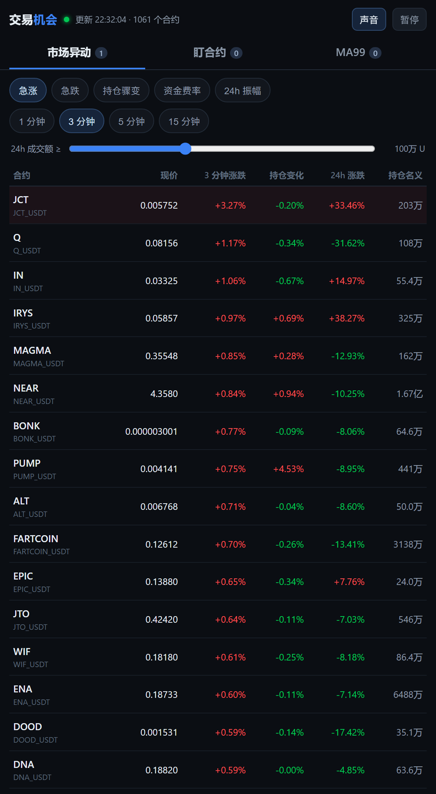
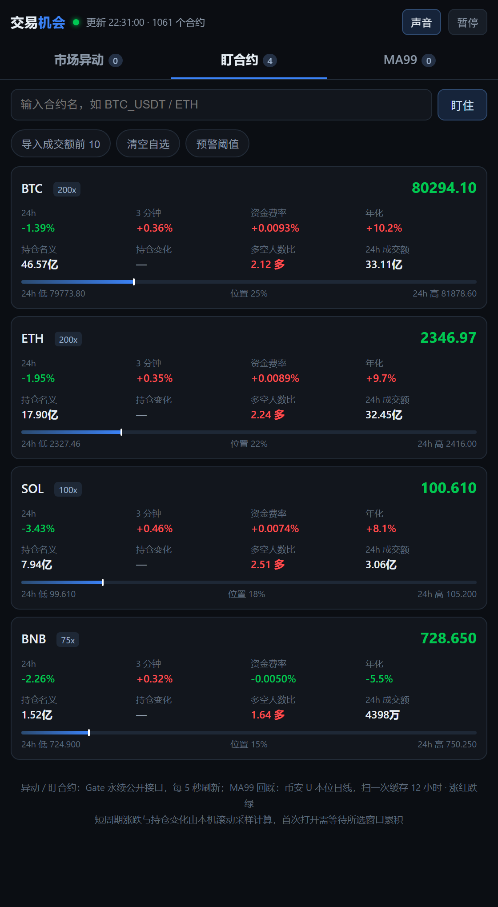
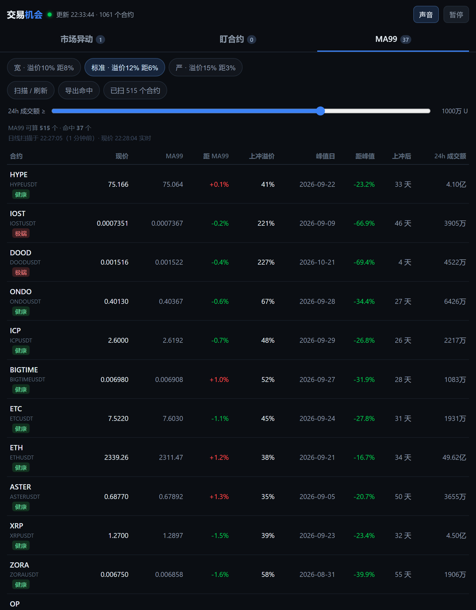

# OppRadar · 机会雷达

> 一块屏幕看完永续合约市场的异动与机会：**急涨急跌、持仓骤变、资金费率、24 小时振幅、自选盯盘、日线 MA99 回踩扫描**。

单文件网页，**不需要安装、不需要后端、不需要注册、不需要 API 密钥**。双击 `index.html` 就能用，手机浏览器同样可用。

<sub>**English** — A zero-install, single-file dashboard for crypto perpetual futures: market movers, open-interest shifts, funding rates, a personal watchlist, and a daily MA99 pullback scanner. No API key, no backend, no login, no build step.</sub>

<p>


</p>



---

## 为什么会有这个东西

交易所 App 的「行情」页只告诉你**现在多少钱**，不告诉你**刚刚发生了什么**：

- 哪 20 个合约在最近 3 分钟里突然拉了 4%？
- 哪个合约价格没动，但持仓量（OI，Open Interest）半小时掉了 8%——有人在大规模平仓？
- 谁的资金费率已经贵到做多要倒贴钱？
- 哪些币冲高之后又缩回日线长期均线附近，正在寻找支撑？

这些信息分散在四五个页面里，要一个个翻。OppRadar 把它们压成三个标签页，5 秒刷新一次。

## 功能

### 一、市场异动

五个榜单，可切换 **1 / 3 / 5 / 15 分钟** 观察窗口：

| 榜单 | 排序依据 | 它在回答什么 |
|---|---|---|
| **急涨** | 窗口内涨跌幅，降序 | 刚刚谁在猛拉 |
| **急跌** | 窗口内涨跌幅，升序 | 刚刚谁在砸盘 |
| **持仓骤变** | 持仓量变化百分比的绝对值 | 资金在进场还是离场（价格没动但持仓暴变，往往是变盘前兆） |
| **资金费率** | 费率绝对值 + 距下次结算倒计时 + 年化 | 多空谁在付钱给谁，挤压方向在哪边 |
| **24h 振幅** | 24 小时最高最低价之差 ÷ 最低价 | 谁在剧烈震荡，做波段的空间在哪 |

底部有「24h 成交额 ≥」滑块（默认 100 万 U），用来过滤掉没量的壳合约——**没有成交量的异动不是异动，是挂单被扫了一下**。

### 二、盯合约

自选列表，存本地，关掉再开还在。每张卡片：

- 现价、24 小时涨跌、N 分钟涨跌
- 资金费率、年化费率、下次结算倒计时
- 持仓名义价值（持仓量 × 合约乘数 × 价格）、持仓变化百分比
- 多空人数比
- 24 小时价格位置条（现价在当日最高最低之间的位置）

支持「导入成交额前 10」一键填满，也支持手动输入合约名。**预警**：窗口涨跌或资金费率越过阈值时，页面横幅提示 + 可选提示音。

### 三、MA99 回踩

在币安全部 U 本位永续里，找出**「先冲高、再缩回日线 MA99 附近」**的币。

「MA99」= 99 日简单移动平均线（Simple Moving Average，把最近 99 根日线的收盘价加起来除以 99）。它是长期成本的粗略代表，价格回落到这里，通常意味着前期获利盘已经消化得差不多。

三档预设：

| 预设 | 上冲溢价门槛 | 距 MA99 容差 | 含义 |
|---|---|---|---|
| 宽 | ≥ 10% | ≤ 8% | 宁多不漏 |
| **标准（默认）** | **≥ 12%** | **≤ 6%** | 平衡 |
| 严 | ≥ 15% | ≤ 3% | 只留最贴线的 |

命中结果表：合约、现价、MA99、距 MA99、上冲溢价、峰值日、距峰值、上冲后过了多少天、24h 成交额。每行带一个标签：

- **健康**：上冲溢价 < 100% 且从峰值回落 < 40% —— 正常的涨后退潮
- **极端**：上冲溢价 ≥ 100% 或从峰值回落 ≥ 40% —— 多半是炒作崩塌后的残骸，均线已经被砸平了，贴上去没有支撑意义

支持一键导出 CSV（逗号分隔值文件，Excel 可直接打开）。

## 快速开始

### 方式一：直接双击

下载后双击 `index.html`，用浏览器打开即可。**没有任何依赖**。

### 方式二：本地服务器（推荐）

```bash
python start.py
```

脚本会做四件事：只绑定 `127.0.0.1`（本机回环地址，局域网其他设备也访问不到）、端口交给操作系统随机分配、禁止目录浏览、附加安全响应头。然后自动打开浏览器。

```bash
python start.py --port 8787      # 固定端口
python start.py --no-browser     # 只起服务
```

Windows 用户也可以直接双击 `start.bat`。

> **为什么推荐服务器方式**：浏览器对 `file://` 打开的所有本地网页共用同一份本地存储，你电脑上任何本地 HTML 都能读到本页存的"自选合约"。走 `http://127.0.0.1` 是独立来源，天然隔离。

### 方式三：丢到任意静态托管

它就是纯静态 HTML，扔进 Nginx、GitHub Pages、Vercel 都能跑。

## 数据从哪来

| 模块 | 数据源 | 刷新 |
|---|---|---|
| 市场异动、盯合约 | 币安 U 本位永续公开行情接口 `fapi.binance.com` | 每 5 秒 |
| MA99 回踩 | 同一个币安接口的日线 | 日线扫一次，缓存 12 小时 |

**只有一家交易所：币安。全部是公开行情接口，不需要 API 密钥、不需要账户、不需要登录。** 页面没有任何下单能力，读不到你的持仓，也不向任何第三方发送数据。

用的具体端点（都可以自己在浏览器里打开验证）：

| 用途 | 端点 |
|---|---|
| 全市场 24h 行情（一次拿全） | `/fapi/v1/ticker/24hr` |
| 资金费率 + 标记价（一次拿全） | `/fapi/v1/premiumIndex` |
| 合约清单（筛出 USDT 永续） | `/fapi/v1/exchangeInfo` |
| 非 8 小时的结算周期 | `/fapi/v1/fundingInfo` |
| 持仓量（只能逐个查） | `/fapi/v1/openInterest?symbol=` |
| 多空账户比（只能逐个查） | `/futures/data/globalLongShortAccountRatio` |
| K 线（预热与日线） | `/fapi/v1/klines` |

### 为什么持仓量要"轮转"

币安把行情和资金费率做成了"一次请求拿全市场"，但**持仓量没有这种批量接口**，只能一个合约一次请求。523 个 USDT 永续每 5 秒全查一遍，会直接打爆币安的权重上限（每分钟 2400）。

所以只对**成交额前 150 个合约**取持仓量，每 5 秒取 50 个，约 15 秒轮完一遍。代价写在明处：

- 成交额排在 150 名之外的合约，「持仓名义」「持仓变化」显示「—」，不是 0
- 「持仓变化」的采样精度约 15 秒，比价格快照粗
- 跑 MA99 全市场扫描时（500+ 个请求），持仓量轮转自动暂停，避免撞上限

多空账户比同理：只查自选里的那几个合约，5 分钟内复用，币安没提供该数据的合约显示「—」。


## 几个必须说清楚的口径

### 1. 涨红跌绿

遵循中国市场习惯：**涨是红色，跌是绿色**，与欧美相反。

### 2. 短周期涨跌是自己算的，不是交易所给的

交易所只提供"当前价格"，不提供"最近 3 分钟涨了多少"。所以页面每 5 秒存一份全市场快照（环形缓冲区存 200 份，约 16.7 分钟），用当前价减去 N 分钟前的价格。

**代价**：刚打开页面时没有历史快照，必须等窗口累积满。界面会显示"采集进度"和还需多久；这段时间榜单按 24 小时涨跌排序，并**明确标注口径不同**，不会假装是 3 分钟数据。

为了减少等待，页面启动时会拉取自选合约和成交额前 30 名的 1 分钟 K 线做预热。

### 3. 「量比 / 放量」这一列被删掉了

因为它算不对。24 小时成交额是**滚动值**，让两个时刻的滚动值相减，会同时减掉新进入窗口的部分、又被已经滑出窗口的部分抵消，结果是一堆 0.0~0.2 倍的假数字。

要算真实的窗口成交量，得给 500 多个合约逐个拉 K 线。单请求架构做不到，所以**宁可不给这一列，也不给一个错的口径**。

### 4. MA99 的算法细节

- 只使用**已收盘**日线：最后一根是今天没走完的，直接剔除，避免盘中价格污染均线
- 数据不足 101 根日线的合约直接跳过，不用近似值凑
- 「上冲溢价」= 近 60 个交易日里，某一天的**最高价 ÷ 当天自己的 MA99** 的最大值。注意是**当天的均线比当天的高点**，不是拿今天的均线去比一个月前的高点——后者会让持续上涨的币虚高
- 「距峰值」= 现价 ÷ 上冲最高价 − 1
- 「现价」和「24h 成交额」是实时的，日线扫描结果是离线的，表头会标注"日线扫描于 X 点（N 小时前）· 现价 X 点实时"，不混为一谈
- 现价与日线口径差超过 90% 的合约直接判定为异常（同名不同计价的合约），不参与命中

### 5. 命中数量会随行情变化，也会随门槛变化

同样的扫描，改动「上冲溢价」和「距 MA99」两个数字，命中数会从几个变到几十个。**这不是 bug，是筛选条件本身在起作用。**

## 自定义

| 位置 | 可调项 | 默认值 |
|---|---|---|
| 异动页滑块 | 24h 成交额门槛 | 100 万 U |
| 异动页标签 | 观察窗口 | 3 分钟 |
| 盯合约页「预警阈值」 | 窗口涨跌 / 资金费率 | 1.5% / 0.1% |
| MA99 页三档预设 | 上冲溢价 / 距 MA99 | 12% / 6% |
| MA99 页滑块 | 24h 成交额门槛 | 1000 万 U |
| MA99 内部常量 | 回看天数 `lb`、深度回落阈值 `deep` | 60 根 / 5% |

自选合约、预警阈值、声音开关存在浏览器本地存储，不上传。

## 安全与隐私

这个项目从设计上就没有"账号"这个概念，所以不存在账号泄露。

- **无密钥**：没有 API key、没有私钥、没有助记词，代码里搜不到任何凭证
- **无后端**：没有服务器接收你的数据，所有计算在浏览器里完成
- **网络白名单**：通过 CSP（Content Security Policy，内容安全策略）把可连接的域名钉死为**只有一个** `fapi.binance.com`，其他域名一律被浏览器拦下。即使将来有人往页面里塞统计脚本或后门，也发不出去
- **无外链**：不加载任何外部脚本、字体、图片、CDN，断网也能打开界面
- **不外发来源**：`Referrer-Policy: no-referrer`，请求交易所时不带来源页信息
- **本地存储只存代码**：存的是 `BTCUSDT` 这种合约名和几个阈值数字，不涉及任何身份信息
- **XSS（跨站脚本）防护**：所有来自接口的字符串（合约名等）插入页面前都做 HTML 转义

**唯一无法避免的暴露**：任何直连交易所的网页工具，交易所都能看到你的公网 IP。但看不到账户、持仓、订单——因为这个页面没有登录，也没有交易接口。

## 已知限制

1. **需要能访问币安**。部分地区直连 `fapi.binance.com` 会超时，需要代理或换个网络。页面会如实显示"连接失败，重试中…"，不会拿假数据糊弄。
2. **MA99 首次扫描要 1~2 分钟**。要发 500 多个请求（每个合约一次日线），并发 8 路。扫完缓存 12 小时，第二次打开是秒开的。
3. **随机端口会让自选丢失**。浏览器按"协议 + 主机 + 端口"隔离本地存储，端口每次变就是新来源。想让浏览器记住自选，用 `--port 8787` 固定端口。
4. **持仓量只覆盖成交额前 150 个合约**（币安没有批量持仓量接口），其余显示「—」，见上文「为什么持仓量要轮转」。
4. **公开接口有速率限制**。5 秒一次全市场行情（约 1000 个合约一个请求）没问题，但别把刷新间隔改到 1 秒。
5. **这不是交易信号**。它只做价格位置和资金面的筛选，不看成交量结构、不看链上数据、不做回测。命中不等于该买。

## 目录结构

```
oppradar/
├── index.html                 # 全部界面与逻辑（单文件，无构建步骤）
├── start.py                   # 本地预览服务器（只绑定 127.0.0.1，随机端口）
├── start.bat                  # Windows 双击启动
├── docs/                      # 截图
│   ├── screenshot-move.png
│   ├── screenshot-watch.png
│   └── screenshot-ma99.png
├── LICENSE
└── README.md
```

## 常见问题

**Q：数据是实时的吗？**
异动和盯合约是实时的（5 秒一轮）。MA99 的日线数据是扫描那一刻的，缓存 12 小时；但表里的"现价"和"距 MA99"会跟着实时价格变。

**Q：为什么打开后榜单是空的？**
前 15 秒在拉全市场合约列表，之后每 5 秒采一次。短周期榜要等窗口累积，页面会显示还要多久。

**Q：能加更多交易所吗？**
能。数据层（`API_TICK`、`API_CON` 两个常量 + 字段映射）和界面层是分开的，换源主要是改 `compute()` 里的字段映射。注意 CSP 白名单要同步加域名，否则请求会被浏览器拦。

**Q：能自动交易吗？**
不能，也不打算做。这个工具刻意不接私钥、不下单。真要做交易，请在交易所官方接口上自己搭，并做好风控。

## 免责声明

本项目仅用于行情观察与技术学习，**不构成任何投资建议**。加密货币合约为高风险杠杆产品，可能导致本金全部损失。数据来自交易所公开接口，可能存在延迟、缺失或错误，不对其准确性作任何担保。使用本工具产生的任何盈亏与作者无关。

## 许可

[MIT License](LICENSE) —— 可以自由使用、修改、分发，包括商业用途，保留版权声明即可。

---

<sub>OppRadar · 机会雷达 · 用浏览器看市场，而不是用眼睛盯盘。</sub>
